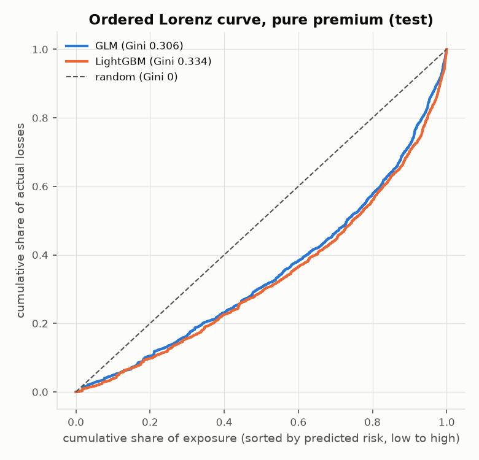
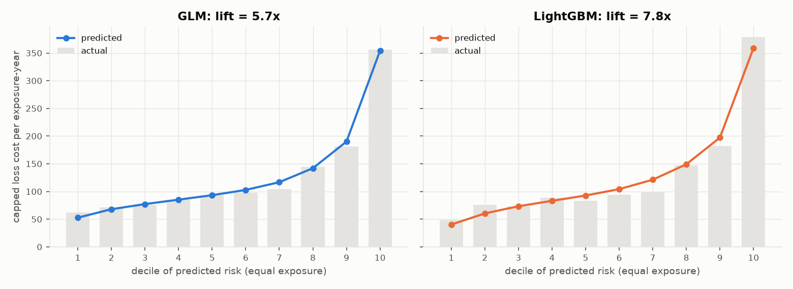
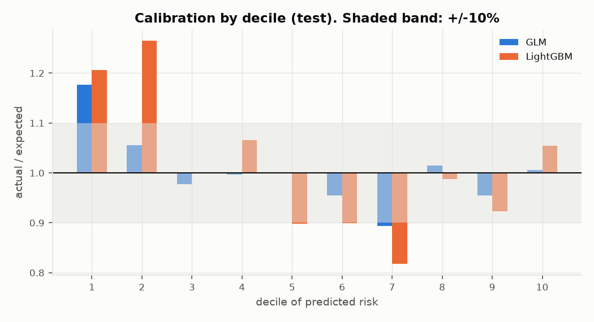
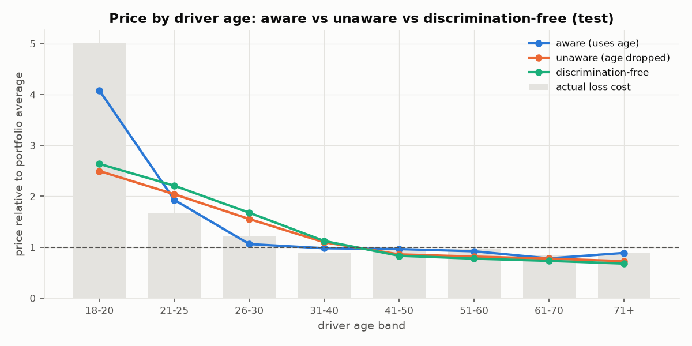
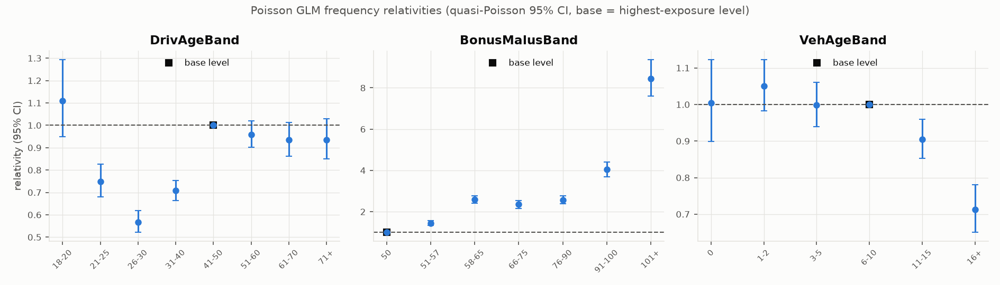
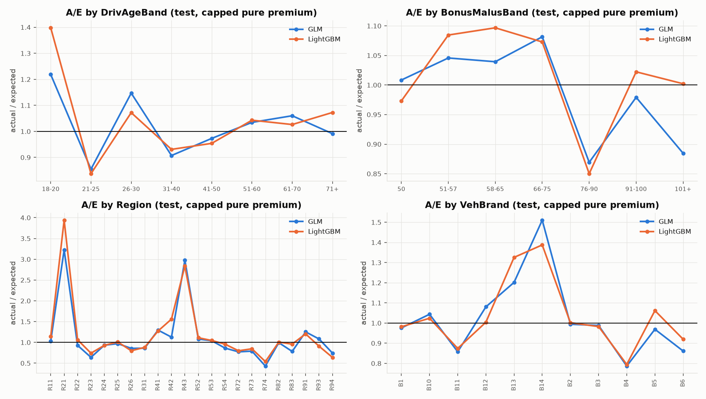
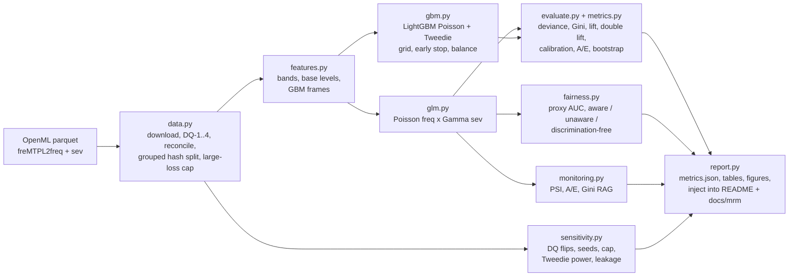

# auto-pricing-model-risk

[](https://github.com/AwpDemon/auto-pricing-model-risk/actions/workflows/ci.yml)

**A motor-insurance pricing model built on 669k real French policies, validated the way a model-risk team would validate it, with the governance pack included.**

Real public data (freMTPL2, OpenML, CC0). No synthetic data. Every number below is produced by
`python -m autopricing run` and injected into this file from `reports/metrics.json`; a test fails if they
ever disagree.

**The question.** Can a classical, filing-friendly GLM price motor liability risk well enough, and what does
an independent-style model-risk review find when it challenges that GLM with a gradient-boosted model?

**The answer, in five lines** (hold-out test set of 133,627 policies):

1. The Poisson x Gamma GLM is well calibrated in total (A/E 0.992) and ranks risk with a Gini of **0.306**
   (the top decile has 5.7x the loss cost of the bottom decile).
2. A LightGBM challenger ranks measurably better (Gini **0.334**; paired-bootstrap gain +0.027, 95% CI +0.011
   to +0.050) and wins the double-lift chart in 8 of 10 deciles. The gain is in claim **frequency**.
3. The raw LightGBM Tweedie model was **11.6% under-priced** in total (it lacks the GLM balance property);
   fixed with a training-data balance correction.
4. A **9,387-row claims-only block** hidden in the public data would have made the model over-predict claims
   by 35% on test (A/E 0.74). Found, excluded, and documented.
5. Removing driver age from the model **cuts but does not remove** the young-driver surcharge: bonus-malus
   identifies under-26 drivers with AUC 0.94. A discrimination-free price (Lindholm et al., 2022) is computed
   and the cross-subsidies are quantified.

Twelve validation findings, a model card, a monitoring plan with PSI thresholds, and a control mapping to the
NAIC AI Model Bulletin, NY DFS CL 2024-7, Colorado Reg 10-1-1, NIST AI RMF and SR 26-2 (which replaced
SR 11-7 in April 2026) are in [`docs/mrm/`](docs/mrm/). A from-scratch teaching guide is in
[`docs/INTERVIEW_GUIDE.md`](docs/INTERVIEW_GUIDE.md).

## Results

<!-- BEGIN:results -->
Hold-out **test** set: 133,627 policies, 70,742 exposure-years, 5,234 claims (never used for fitting or tuning).

**Pure premium (frequency x severity), capped losses**

| Model | Tweedie deviance (p=1.5) | Deviance explained | Gini | Top/bottom decile lift | Calibration slope | A/E |
|---|---:|---:|---:|---:|---:|---:|
| Null | 74.26 | 0.00% | 0.000 | 1.0x | n/a | 0.991 |
| GLM | 70.67 | 4.84% | 0.306 | 5.7x | 0.956 | 0.992 |
| GLM + age x BM interaction | 70.48 | 5.09% | 0.312 | 6.1x | 0.972 | 0.991 |
| LightGBM | 69.83 | 5.97% | 0.334 | 7.8x | 1.018 | 0.993 |
| LightGBM (before balance correction) | 69.95 | 5.81% | 0.334 | 7.8x | 1.018 | 1.107 |
| LightGBM freq x GLM sev | 69.26 | 6.73% | 0.356 | 6.8x | 1.054 | 0.995 |

**Claim frequency (Poisson, exposure offset)**

| Model | Poisson deviance | Deviance explained | Gini | Calibration slope | A/E |
|---|---:|---:|---:|---:|---:|
| Null | 0.4823 | 0.00% | 0.000 | n/a | 1.004 |
| GLM (BonusMalus only) | 0.4657 | 3.45% | 0.212 | 0.941 | 1.006 |
| GLM | 0.4593 | 4.78% | 0.291 | 0.958 | 1.005 |
| GLM + age x BM interaction | 0.4586 | 4.92% | 0.296 | 0.960 | 1.005 |
| LightGBM | 0.4520 | 6.28% | 0.322 | 1.008 | 1.008 |

Paired bootstrap (200 resamples of the test set): LightGBM minus GLM Gini = +0.027 on pure premium (95% CI +0.011 to +0.050) and +0.030 on frequency (95% CI +0.023 to +0.038).

Severity GLM (Gamma) on test claims: deviance explained 0.02%, Gini 0.024. Severity is close to unpredictable from these rating factors; almost all of the pricing signal is in frequency.
<!-- END:results -->

| Lorenz curve (test) | Double lift: GLM vs LightGBM (test) |
|---|---|
|  |  |

| Lift by decile (test) | Calibration by decile (test) |
|---|---|
|  |  |

### Fairness: removing a variable does not remove its effect

<!-- BEGIN:fairness -->
- Other rating factors predict a young driver (age <= 25) with AUC **0.940** (BonusMalus alone: 0.914; top proxy by gain: BonusMalus).
- Price index for drivers aged 18-20 (1.00 = portfolio average): aware **4.08**, unaware (age removed) **2.50**, discrimination-free **2.64**.
- Test Gini: aware 0.306, unaware 0.288, discrimination-free 0.286.
<!-- END:fairness -->



Driver age is the only sensitive-type attribute in the data (there is no race, sex or religion), so it is
used as a stand-in to demonstrate the method. "Aware" uses age; "unaware" drops age and refits;
"discrimination-free" averages the aware model over the population age mix so age cannot leak back through
correlated factors. All three collect the same total premium. Age-blind prices under-charge drivers aged
18-20 (A/E about 1.9-2.0) and over 40, and over-charge drivers aged 21-40, whose high bonus-malus reflects
being new rather than being risky. Whether to use age is a business and legal decision; this analysis
quantifies the trade-off and draws no legal conclusion. Details: [validation report, section 8](docs/mrm/validation_report.md#8-fairness-and-proxy-discrimination)
and finding V-08.

### Monitoring demonstration

<!-- BEGIN:monitoring -->
| Scenario | Policies | Overall | Worst PSI (factor) | A/E |
|---|---:|---|---|---:|
| Hold-out test book (expected: stable) | 133,627 | AMBER | 0.000 (Region) | 0.992 |
| Paris region only (R11), real subset | 13,810 | RED | 12.186 (Region) | 1.032 |
| Young drivers (age < 30), real subset | 17,748 | RED | 10.986 (DrivAge) | 1.040 |
<!-- END:monitoring -->

The hold-out book is stable, as a random split should be. The other two rows are **real subsets of the test
set used as stress scenarios**, not new data; the monitor flags them on the factors that define them.
Full plan, thresholds and escalation: [`docs/mrm/monitoring_plan.md`](docs/mrm/monitoring_plan.md).

## Validation findings (summary)

| ID | Severity | Finding | Status |
|---|---|---|---|
| V-01 | High | Claims-only block in source data (9,387 rows, 97% of their claims without amounts) | Remediated (excluded) |
| V-03 | Medium | LightGBM Tweedie not balanced (raw test A/E 1.107) | Remediated (balance factor 1.116) |
| V-04 | High | GLM leaves measurable lift unpriced vs GBM; an age x BM interaction recovers about a fifth | Open |
| V-06 | High | Flat large-loss load is volatile (one 4.08M claim) | Open |
| V-08 | Medium | Bonus-malus proxies youth; age-blind prices create cross-subsidies | Open (owner decision) |
| V-12 | Low | Fixed Gini monitoring threshold is tighter than sampling noise | Open |

All twelve, with evidence and actions: [`docs/mrm/issues_log.md`](docs/mrm/issues_log.md).

## Interpretability

| GLM frequency relativities with 95% CI | GLM vs LightGBM SHAP-implied relativities |
|---|---|
|  |  |



More figures: [EDA one-way frequencies](docs/figures/eda_oneway_frequency.png),
[severity distribution](docs/figures/eda_severity_distribution.png),
[SHAP importance](docs/figures/shap_importance.png), [monitoring PSI](docs/figures/monitoring_psi.png).

## Data and cleaning

| | |
|---|---|
| Source | [freMTPL2freq](https://www.openml.org/d/41214) (OpenML 41214) and [freMTPL2sev](https://www.openml.org/d/41215) (OpenML 41215): French motor third-party-liability policies and claims |
| Licence | **CC0** per the OpenML listings (checked 2026-10-10). Originally from the R package [CASdatasets](https://github.com/dutangc/CASdatasets) (Dutang and Charpentier), licensed **GPL (>= 2)**. Cite: C. Dutang and A. Charpentier (2018), CASdatasets: Insurance datasets |
| In this repo | A 20,000-policy random sample (`data/sample/`, used by CI). The pipeline downloads the full data (about 7.7 MB), which is git-ignored; `data/raw/MANIFEST.json` records URL and sha256 |

<!-- BEGIN:data -->
| Step | Rows affected |
|---|---:|
| Raw policies (freMTPL2freq) | 678,013 |
| Raw claim records (freMTPL2sev) | 26,639 |
| DQ-1: claims-only block removed (IDpol < 24,952; 100% have claims, 96.9% of those have no amount) | 9,387 |
| DQ-2: policies whose ClaimNb disagreed with claim records (reconciled) | 23 |
| DQ-3: policies with ClaimNb capped at 4 | 8 |
| DQ-4: policies with exposure capped at 1 year | 1,224 |
| Clean policies / exposure-years / claims | 668,626 / 353,560 / 26,098 |
| Large-loss cap (99.5th pct of train claims) / claims above it / load factor | 39,196 / 79 / 1.258 |
| Split train / validation / test (policies) | 401,585 / 133,414 / 133,627 |
<!-- END:data -->

## Architecture



## Run it

```bash
python -m venv .venv && source .venv/bin/activate      # Windows: .venv\Scripts\activate
pip install -r requirements.txt && pip install -e . --no-deps
python -m autopricing run            # downloads data on first run; 6-8 min on a 16-core desktop, longer under load
pytest                                # includes an end-to-end run on the committed sample
```

Other commands: `python -m autopricing run --sample` (20k-policy sample, under a minute, writes to `out/sample/`),
`python -m autopricing score deploy/io/policies.csv scored.csv` (score new policies with the saved GLM),
`python -m autopricing report` (re-inject numbers into the docs). A Dockerfile and compose file are in
[`deploy/`](deploy/) (not deployed anywhere).

Everything is seeded (`config/default.yaml`); two consecutive full runs produced identical results.

## Repository map

| Path | What |
|---|---|
| `src/autopricing/` | Package: `data`, `features`, `glm`, `gbm`, `metrics`, `evaluate`, `fairness`, `monitoring`, `sensitivity`, `plots`, `report`, `scoring`, `pipeline`, `cli` |
| `config/default.yaml` | Every modelling choice and threshold |
| `reports/metrics.json`, `reports/tables/` | All generated numbers (committed) |
| `models/` | GLM coefficients (JSON) and LightGBM models (text) |
| `docs/mrm/` | Model card, development document, validation report, issues log, monitoring plan, control mapping, inventory entry |
| `docs/INTERVIEW_GUIDE.md` | Teaching guide: GLMs, Tweedie, Gini, validation, fairness, frameworks, Q&A |
| `tests/` | Metrics vs scikit-learn, GLM parameter recovery, cleaning rules, split integrity, fairness invariance, monitoring, doc/number consistency, end-to-end sample run |

## Limitations

- **No out-of-time validation**: the dataset has no dates, so the split is random (grouped by rating profile).
- **Losses as recorded**: not developed to ultimate; no IBNR.
- **No protected attributes**: the fairness analysis demonstrates the method with age as a stand-in; it is not a disparate-impact test.
- **Self-validated**: the validation is independent in style only.
- **Risk premium only**: no expenses, profit, or regulatory constraints; not a filed rate.
- **Undocumented provenance** of the claims-only block: the treatment is inferred from the data.
- The regulatory crosswalk is a portfolio exercise, not legal or compliance advice.

## What I would do next

1. Close V-04: a GBM-guided interaction search (SHAP interaction values) and spline effects for BM and age, then re-run the double lift.
2. Close V-06: fit a generalised Pareto tail above the cap and report the load with a confidence interval.
3. Negative binomial frequency, plus credibility-weighted region and brand levels (V-10).
4. Bootstrap-based monitoring thresholds (V-12) and a scheduled monitoring job.
5. With US data: BIFSG-based protected-class testing following NY DFS CL 2024-7.

## References

- Noll, Salzmann, Wüthrich (2018), *Case Study: French Motor Third-Party Liability Claims*, SSRN 3164764.
- Lindholm, Richman, Tsanakas, Wüthrich (2022), *Discrimination-Free Insurance Pricing*, ASTIN Bulletin 52(1).
- Frees, Meyers, Cummings (2011), *Summarizing Insurance Scores Using a Gini Index*, JASA 106(495).
- Goldburd, Khare, Tevet, Guller (2020), *Generalized Linear Models for Insurance Rating*, CAS Monograph 5, 2nd ed.
- Federal Reserve / OCC / FDIC, SR 26-2 *Revised Guidance on Model Risk Management* (17 Apr 2026), superseding SR 11-7 (2011).
- NAIC, *Model Bulletin: Use of Artificial Intelligence Systems by Insurers* (4 Dec 2023); NY DFS Insurance Circular Letter No. 7 (2024); Colorado 3 CCR 702-10, Regulation 10-1-1 (amended 2025); NIST AI RMF 1.0 (2023); Regulation (EU) 2024/1689, Annex III 5(c).

Author: Ali Askari. Code licence: MIT.
