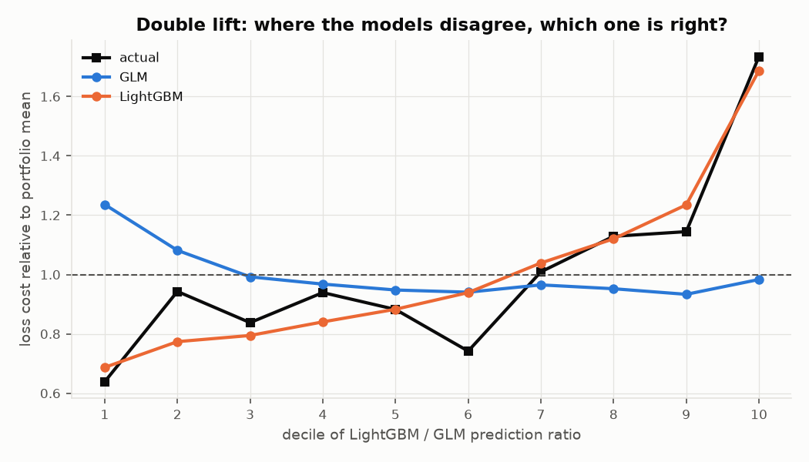
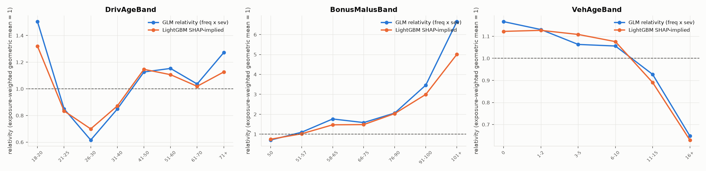

# Validation report: MTPL-RP-GLM-001 (Motor TPL risk-premium GLM)

| | |
|---|---|
| Model | Poisson frequency GLM x Gamma severity GLM x large-loss load (`docs/mrm/model_development.md`) |
| Challenger | LightGBM Tweedie (p = 1.5) pure premium; LightGBM Poisson frequency |
| Tier | 1 (high materiality: sets the risk premium of the whole book) |
| Validation type | Initial validation, **independent-style** (developer and validator are the same person; finding V-07) |
| Date | 2026-10-10 |
| Reproduce | `python -m autopricing run` (all numbers below are generated into `reports/metrics.json`) |
| Reference frameworks | Model-risk vocabulary of SR 11-7 (2011), **superseded by SR 26-2 on 17 Apr 2026**; NAIC AI Model Bulletin (Dec 2023); NY DFS CL 2024-7; Colorado Reg 10-1-1 (amended 2025); NIST AI RMF 1.0. Crosswalk: `control_mapping.md` |

## 1. Summary and rating

**Rating: Fit for purpose with conditions** (for use as the loss-cost basis of a rate indication; not for
underwriting decisions). The LightGBM challenger is **not approved for pricing**.

The GLM is conceptually sound, well calibrated in total on hold-out data (test A/E 0.992), and ranks risk
materially better than a one-factor model. Twelve findings are logged (`issues_log.md`); four are High:

- **V-01 (data)**: a 9,387-row claims-only block in the source would have biased the model badly
  (test A/E 0.74 if kept). Excluded; provenance to be confirmed.
- **V-04 (performance)**: the GBM ranks risk measurably better (Gini +0.027, 95% CI +0.011 to +0.050) and
  wins the double lift in 8 of 10 deciles; the gap is in frequency. The GLM leaves lift unpriced.
- **V-06 (assumption)**: the flat large-loss load is volatile; one 4.08M claim moves a split's
  uncapped/capped ratio from about 1.26 to 1.74.
- **V-08 (fairness)**: bonus-malus is a strong proxy for youth; dropping age does not remove its effect.

**Conditions**: (1) confirm V-01 with the data owner; (2) replace the flat load with a multi-year or
tail-fitted large-loss method (V-06); (3) complete an interaction review (V-04) before the next filing;
(4) independent review (V-07); (5) protected-class testing on US data before any US use (V-08).

## 2. Conceptual soundness

| Choice | Assessment |
|---|---|
| Frequency x severity decomposition | Standard collective-risk approach; appropriate. Independence of count and size given rating factors is assumed, not tested. |
| Poisson, log link, log-exposure offset | Appropriate for counts proportional to time at risk; multiplicative structure matches tariff practice. Pearson dispersion 1.73: over-dispersion handled by quasi-Poisson standard errors; point estimates unaffected. Negative binomial not tested (V-10). |
| Gamma, log link, claim-count weights | Appropriate for positive, right-skewed amounts with roughly constant CV below the cap. Weak explanatory power (V-11). |
| Banding and base levels | Bands chosen from one-way exposure/frequency; base = highest exposure. Reasonable; finer structure (splines) could add lift (V-04). |
| `Area` excluded | Justified: Spearman 0.98 with log density. |
| Large-loss cap at train 99.5th percentile + flat load | Accepted practice; cap computed on training data only (no test leakage). Load estimate unstable (V-06). |
| Exposure-weighted grouped split | Sound: no rating profile crosses splits (asserted in code: 0 crossings). No out-of-time sample available (V-09). |
| GBM: early stopping on validation, small grid, balance correction | Sound after remediation of V-03. |

## 3. Data review

<!-- BEGIN:data -->
| Step | Rows affected |
|---|---:|
| Raw policies (freMTPL2freq) | 678,013 |
| Raw claim records (freMTPL2sev) | 26,639 |
| DQ-1: claims-only block removed (IDpol < 24,952; 100% have claims, 96.9% of those have no amount) | 9,387 |
| DQ-2: policies whose ClaimNb disagreed with claim records (reconciled) | 23 |
| DQ-3: policies with ClaimNb capped at 4 | 8 |
| DQ-4: policies with exposure capped at 1 year | 1,224 |
| Clean policies / exposure-years / claims | 668,626 / 353,560 / 26,098 |
| Large-loss cap (99.5th pct of train claims) / claims above it / load factor | 39,196 / 79 / 1.258 |
| Split train / validation / test (policies) | 401,585 / 133,414 / 133,627 |
<!-- END:data -->

The decisive data finding is V-01 (claims-only block). Sensitivity of each cleaning decision on the same
grouped split, evaluated on the baseline test set (`reports/tables/sensitivity_data_decisions.md`):

| Variant | Test A/E (frequency) | Test Gini | BM 101+ relativity |
|---|---:|---:|---:|
| Baseline (all decisions on) | 1.006 | 0.291 | 8.45 |
| DQ-1 off: keep block with reported counts | **0.740** | **0.247** | **5.87** |
| DQ-1 off: keep block, counts reconciled to amounts | 1.005 | 0.291 | 8.43 |
| DQ-2 off / DQ-3 off / DQ-4 off | 1.004 to 1.006 | 0.291 | 8.41 to 8.45 |

Reading: the block matters only if its reported counts are believed. Reconciling counts to recorded amounts
neutralises it (most of its claims have no amount), but that silently turns 9,387 claim records into
zero-claim policies, which is also wrong. Exclusion is the correct treatment.

## 4. Outcomes analysis (hold-out test set)

<!-- BEGIN:results -->
Hold-out **test** set: 133,627 policies, 70,742 exposure-years, 5,234 claims (never used for fitting or tuning).

**Pure premium (frequency x severity), capped losses**

| Model | Tweedie deviance (p=1.5) | Deviance explained | Gini | Top/bottom decile lift | Calibration slope | A/E |
|---|---:|---:|---:|---:|---:|---:|
| Null | 74.26 | 0.00% | 0.000 | 1.0x | n/a | 0.991 |
| GLM | 70.67 | 4.84% | 0.306 | 5.7x | 0.956 | 0.992 |
| GLM + age x BM interaction | 70.48 | 5.09% | 0.312 | 6.1x | 0.972 | 0.991 |
| LightGBM | 69.83 | 5.97% | 0.334 | 7.8x | 1.018 | 0.993 |
| LightGBM (before balance correction) | 69.95 | 5.81% | 0.334 | 7.8x | 1.018 | 1.107 |
| LightGBM freq x GLM sev | 69.26 | 6.73% | 0.356 | 6.8x | 1.054 | 0.995 |

**Claim frequency (Poisson, exposure offset)**

| Model | Poisson deviance | Deviance explained | Gini | Calibration slope | A/E |
|---|---:|---:|---:|---:|---:|
| Null | 0.4823 | 0.00% | 0.000 | n/a | 1.004 |
| GLM (BonusMalus only) | 0.4657 | 3.45% | 0.212 | 0.941 | 1.006 |
| GLM | 0.4593 | 4.78% | 0.291 | 0.958 | 1.005 |
| GLM + age x BM interaction | 0.4586 | 4.92% | 0.296 | 0.960 | 1.005 |
| LightGBM | 0.4520 | 6.28% | 0.322 | 1.008 | 1.008 |

Paired bootstrap (200 resamples of the test set): LightGBM minus GLM Gini = +0.027 on pure premium (95% CI +0.011 to +0.050) and +0.030 on frequency (95% CI +0.023 to +0.038).

Severity GLM (Gamma) on test claims: deviance explained 0.02%, Gini 0.024. Severity is close to unpredictable from these rating factors; almost all of the pricing signal is in frequency.
<!-- END:results -->

Additional evidence (`reports/tables/`):

- **Calibration by decile** (`lift_pure_premium_glm.md`): GLM A/E ranges from 0.89 (decile 7) to 1.18
  (decile 1); the low-risk end is under-priced (V-05). Total A/E 0.992.
- **A/E by rating factor** (`ae_by_factor_test.md`), levels with more than 1,000 exposure-years: worst GLM
  deviation 15% (driver age), 13% (BM), 30% (region), 21% (brand). Region and brand deviations sit in levels
  with wide relativity CIs (V-10).
- **Train vs test**: GLM pure-premium Gini 0.331 train / 0.306 test; GBM 0.500 / 0.334. The GBM over-fits
  far more, as expected; its test performance is still better.

## 5. Benchmarking

| Comparison | Result | Reading |
|---|---|---|
| GLM vs null | Pure-premium deviance explained 4.8%, Gini 0.306 | The model has real signal. Low D^2 is normal for claim data (mostly random). |
| GLM vs BonusMalus-only GLM | Frequency Gini 0.291 vs 0.212 | BM alone carries about 70% of the ranking power. |
| GLM vs LightGBM | Gini +0.027 pure premium (CI +0.011 to +0.050); +0.030 frequency (CI +0.023 to +0.038); double-lift MAE 0.237 vs 0.073 | Real, statistically clear gap (V-04). |
| LightGBM frequency x GLM severity | Best Gini, 0.356 | The GBM's advantage is in frequency; a Tweedie GBM on total loss is not the best way to use it. |
| GLM + age x BM interaction (v1.1 candidate) | Gini 0.306 to 0.312; frequency deviance explained 4.78% to 4.92% | Helps, recovers about a fifth of the gap; more structure is missing. |
| Raw LightGBM before balance correction | Test A/E 1.107 | Remediated (V-03). |

## 6. Sensitivity and stability

| Test | Result | File |
|---|---|---|
| Split seed (3 re-splits) | Frequency test Gini 0.289 to 0.315; age 18-20 relativity 1.19 to 1.23; BM 101+ 7.3 to 8.1 | `sensitivity_split_seeds.md` |
| Large-loss cap 99% / 99.5% / 99.9% / none | Load 1.38 / 1.26 / 1.08 / 1.00; test A/E on uncapped losses about 1.37 at every cap (dominated by one 4.08M claim); severity age 18-20 relativity 1.16 / 1.20 / 1.33 / 2.71 | `sensitivity_large_loss.md` |
| Tweedie power 1.3 / 1.5 / 1.7 (GBM) | Test Gini 0.336 / 0.334 / 0.333: insensitive. Raw A/E 1.08 / 1.11 / 1.14: the higher the power, the larger the balance gap | `sensitivity_tweedie_power.md` |
| Grouped vs naive row split (GBM frequency) | Test Gini 0.322 vs 0.330: within split-to-split noise; leakage neither shown nor excluded | `sensitivity_split_leakage.md` |

Split-to-split variation (about 0.026 of Gini) is as large as some model differences, which is why every
model comparison in this report uses a paired bootstrap on a fixed test set.

## 7. Interpretability

- GLM: full relativity tables with quasi-Poisson 95% CIs (`glm_frequency_relativities.md`,
  `glm_severity_relativities.md`).
- GBM: TreeSHAP values (LightGBM `pred_contrib`; additivity verified to 1.2e-14). BM dominates (mean |SHAP|
  0.40 on the log scale), then driver age (0.15) and vehicle age (0.13).
- GLM vs SHAP-implied relativities by band agree in shape for age, BM and vehicle age; the GBM is flatter at
  the extremes (age 18-20: 1.32 vs GLM 1.50; BM 101+: 5.0 vs 6.6), consistent with GBM shrinkage in thin cells.

## 8. Fairness and proxy discrimination

<!-- BEGIN:fairness -->
- Other rating factors predict a young driver (age <= 25) with AUC **0.940** (BonusMalus alone: 0.914; top proxy by gain: BonusMalus).
- Price index for drivers aged 18-20 (1.00 = portfolio average): aware **4.08**, unaware (age removed) **2.50**, discrimination-free **2.64**.
- Test Gini: aware 0.306, unaware 0.288, discrimination-free 0.286.
<!-- END:fairness -->

The dataset contains no protected class, so driver age is used as a stand-in. Results and the limits of the
analysis are in finding V-08 and `docs/INTERVIEW_GUIDE.md` section 7. No legal conclusion is drawn; age is a
permitted rating factor in French motor insurance.

## 9. Ongoing monitoring

Plan and thresholds: `monitoring_plan.md`. Demonstration on real sub-books:

<!-- BEGIN:monitoring -->
| Scenario | Policies | Overall | Worst PSI (factor) | A/E |
|---|---:|---|---|---:|
| Hold-out test book (expected: stable) | 133,627 | AMBER | 0.000 (Region) | 0.992 |
| Paris region only (R11), real subset | 13,810 | RED | 12.186 (Region) | 1.032 |
| Young drivers (age < 30), real subset | 17,748 | RED | 10.986 (DrivAge) | 1.040 |
<!-- END:monitoring -->

The fixed Gini threshold turned AMBER on the stable hold-out book because validation and test Gini differ
by sampling noise (V-12).

## 10. Limitations of this validation

No out-of-time data; losses not developed to ultimate; no protected attributes; no expense or profit
loads; self-validation; observation period of the source data undocumented.
